# QuillBench admin guide

This guide is for the people who **run** QuillBench: they create projects, add people,
connect databases, and collect the results. It assumes no prior knowledge. Follow the steps
in order and you will be fine.

If you only want to *annotate* or *write benchmark entries*, you do not need this guide.
Open the web address your admin gave you and sign in.

---

## Contents

1. [The big picture](#1-the-big-picture)
2. [Words used in this guide](#2-words-used-in-this-guide)
3. [Opening QuillBench and signing in](#3-opening-quillbench-and-signing-in)
4. [Using the terminal (only for a few tasks)](#4-using-the-terminal-only-for-a-few-tasks)
5. [Adding people](#5-adding-people)
6. [Project type A: annotate a CSV you already have](#6-project-type-a-annotate-a-csv-you-already-have)
7. [Project type B: build a new benchmark](#7-project-type-b-build-a-new-benchmark)
8. [Watching progress and downloading results](#8-watching-progress-and-downloading-results)
9. [Archiving, backups, and keeping data safe](#9-archiving-backups-and-keeping-data-safe)
10. [Everything from the terminal (reference)](#10-everything-from-the-terminal-reference)
11. [When something goes wrong](#11-when-something-goes-wrong)

---

## 1. The big picture

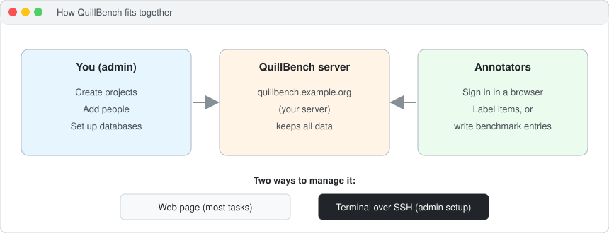

- **QuillBench runs on a server.** The server keeps all the data: projects, answers, accounts.
  Nothing important is stored on your laptop.
- **Everyone uses it in a web browser.** You do not install anything to use it.
- **You manage it in two places:**
  - the **web page** (the Admin tab) for almost everything: projects, uploads, assignments,
    databases, downloads;
  - the **terminal** for a few setup jobs that are deliberately kept off the web page, such as
    creating admins.

Your admin will tell you the web address of your QuillBench server. In this guide we use
the made-up address `quillbench.example.org` and the made-up admin `alex`. Replace them with
your own.

---

## 2. Words used in this guide

| Word | What it means |
|---|---|
| **Admin** | A person who can see the Admin tab and manage everything. Admins can only be made from the terminal. |
| **Annotator** | A normal user. They label items or write benchmark entries. They cannot see the Admin tab. |
| **Project** | One piece of work, e.g. "Sentiment of tweets, round 1". In the menu on the left it is called a *workspace*. |
| **Item** | One row of your CSV file: one thing to label. |
| **Batch** | A group of items, e.g. items 1–100. People are given whole batches, never single items. |
| **Assign** | Give a batch to a person, so it appears on their screen. |
| **Benchmark entry** | One question + its database query + the result, written by a person in a benchmark project. |
| **Connection** | The saved address and login of a database. Only admins see the login details. |
| **Slot** | One box on the benchmark form (a text block, a question box, a dropdown, …), like a question in Google Forms. |

---

## 3. Opening QuillBench and signing in

1. Open the server's web address in Chrome, Firefox, Edge or Safari.
2. Type your **user ID** and **password**, then click **Sign in**.
   If sign-in says your details are wrong, see [section 11](#11-when-something-goes-wrong).
3. As an admin you see the screen below.

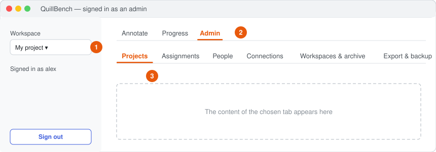

| Number | What it is |
|---|---|
| **1** | **Workspace menu** (left side). Choose which project you are looking at. Every tab works on the project chosen here. |
| **2** | **Admin tab.** Only admins see it. Next to it are **Annotate** (or **Create** for a benchmark project) and **Progress**. |
| **3** | **The admin sub-tabs:** Projects, Assignments, People, Connections, Workspaces & archive, Export & backup. |

> **Brand-new server with no projects yet?** You will see only three tabs:
> **New project**, **Connections** and **People**. They work exactly like the ones described below.

> **No accounts exist yet?** The page tells you to create the first admin from the terminal.
> Do [section 4](#4-using-the-terminal-only-for-a-few-tasks) and then
> [5.1](#51-make-an-admin-terminal-only) first.

---

## 4. Using the terminal (only for a few tasks)

You need the terminal for: creating admins, changing someone's role, restarting QuillBench,
and the reference commands in [section 10](#10-everything-from-the-terminal-reference).

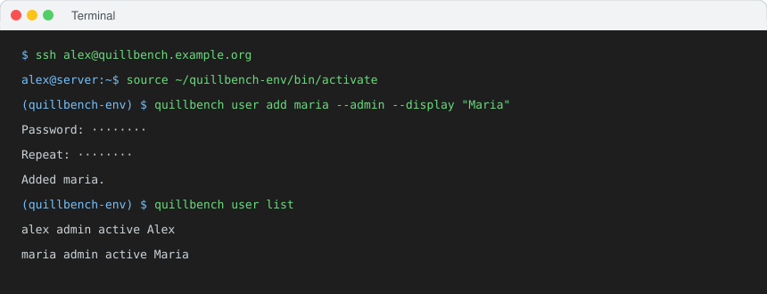

### 4.1 Open a terminal

- **Mac:** press `Cmd + Space`, type `Terminal`, press Enter.
- **Windows:** press the Windows key, type `PowerShell`, press Enter.
- **Linux:** press `Ctrl + Alt + T`.

### 4.2 Log in to the server

Type this and press Enter (use your own user name and the right server):

```bash
ssh alex@quillbench.example.org
```

- The first time, it asks `Are you sure you want to continue connecting?` Type `yes` and press Enter.
- If it asks for a password, type your **server** password. Nothing appears while you type; that is normal.
- You are in when the line starts with something like `alex@server:~$`.

> **Important.** Every QuillBench command in this guide must be run **on the server**,
> after the `ssh` step. If you type them on your own laptop they will fail or change the
> wrong machine.

### 4.3 Make the `quillbench` command available

How you do this depends on how QuillBench was installed on your server. Ask whoever
installed it which line applies. The two usual cases:

**Installed with pip into a virtual environment** (the folder name may differ):

```bash
source ~/quillbench-env/bin/activate
```

**Installed from a git clone** (use the Python that runs QuillBench):

```bash
alias quillbench='python3 -m quillbench'
```

Check that it works:

```bash
quillbench version
```

It prints something like `QuillBench 1.8.1`. You need to do 4.2 and 4.3 every time you open a
new terminal.

### 4.4 Leave the server

```bash
exit
```

---

## 5. Adding people

### 5.1 Make an admin (terminal only)

For safety, admins **cannot** be created on the web page. On the server (section 4):

```bash
quillbench user add maria --admin --display "Maria"
```

- `maria` is the user ID they type to sign in. Use lowercase, no spaces.
- `--display "Maria"` is the name shown on screen (optional).
- It asks for a password twice. Type it (nothing shows), press Enter, type it again.
- Then tell the person their user ID and password privately.

Turn an existing annotator into an admin, or back:

```bash
quillbench user role maria admin
```

```bash
quillbench user role maria annotator
```

> People who sign in with their **university (LDAP) login can never be admins.** This is on
> purpose. Give admins a normal QuillBench password instead.

### 5.2 Add an annotator (web page)

1. Go to **Admin → People**.
2. Under **Add a person**, fill in:
   - **User ID** — what they type to sign in, e.g. `ravi`;
   - **Display name** — e.g. `Ravi Kumar`;
   - **Password** — at least 8 characters. (If your server uses university logins, tick
     **Signs in with their university login** and leave the password empty.)
3. Click **Add**. A green message says `Added ravi.`
4. Send them the web address, user ID and password.

### 5.3 Reset a password, or stop someone signing in (web page)

1. **Admin → People → Change a person.** Choose the person.
2. To reset the password: type a new one in **New password** and click **Save**.
3. To block them: untick **Active (can sign in)** and click **Save**. Their work is kept.
   Tick it again to let them back in.

The same from the terminal:

```bash
quillbench user passwd ravi
```

```bash
quillbench user disable ravi
```

```bash
quillbench user enable ravi
```

```bash
quillbench user list
```

---

## 6. Project type A: annotate a CSV you already have

Use this when you **already have the items** (sentences, images links, queries, …) in a
spreadsheet and you want people to label them.

### 6.1 Prepare your CSV file

- Save the spreadsheet as **CSV** (in Excel: *File → Save As → CSV UTF-8*).
- The first row must be the **column names**, e.g. `id,text`.
- An `id` column is helpful but not required: QuillBench can number rows for you.
- One row = one item.

Example `tweets.csv`:

```text
id,text
t001,I love this phone
t002,The battery died after one day
t003,It is okay I guess
```

### 6.2 Create the project

1. Go to **Admin → Projects** and open **New project**.

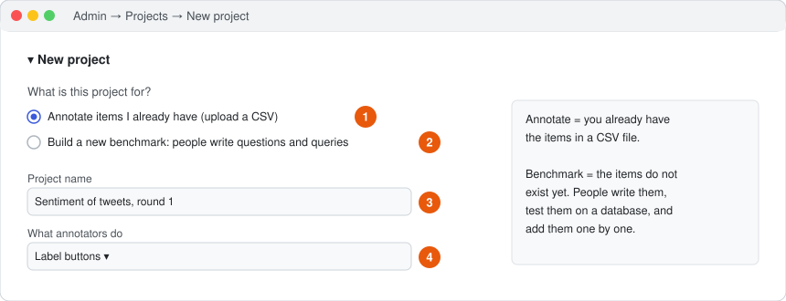

| Number | What to do |
|---|---|
| **1** | Choose **Annotate items I already have (upload a CSV)**. |
| **2** | (The other choice is for benchmarks, see [section 7](#7-project-type-b-build-a-new-benchmark).) |
| **3** | Type a clear **Project name**, e.g. `Sentiment of tweets, round 1`. |
| **4** | Choose **What annotators do** (next picture). |

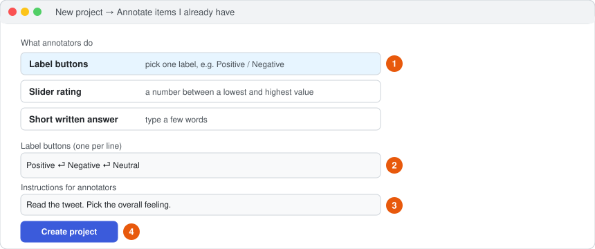

| Number | What to do |
|---|---|
| **1** | Pick the kind of answer: **Label buttons** (choose one label), **Slider rating** (a number), or **Short written answer**. |
| **2** | For label buttons, type **one label per line**, e.g. `Positive`, `Negative`, `Neutral`. For a slider, set the **Lowest**, **Highest** and **Step** instead. |
| **3** | Write **Instructions for annotators**. They see this on every item. Be specific. |
| **4** | Click **Create project**. |

The new project is now selected under **Project**, ready for your file.

### 6.3 Upload the CSV and split it into batches

Still in **Admin → Projects**, with your project chosen in the **Project** box:

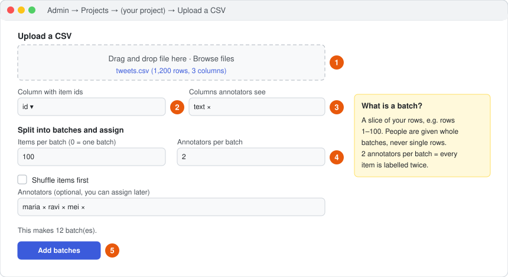

| Number | What to do |
|---|---|
| **1** | Drag your CSV file into the box, or click **Browse files**. Check the row count and the 5-row preview. |
| **2** | **Column with item ids:** choose your `id` column, or **(number the rows for me)**. Ids must be unique. |
| **3** | **Columns annotators see:** keep only the columns people should read. Remove hidden answers or notes. |
| **4** | **Items per batch:** e.g. `100`. `0` keeps everything in one batch. **Annotators per batch:** `1` normally; `2` or more if you want every item labelled by several people (to measure agreement). |
| **5** | Optionally tick **Shuffle items first** and choose **Annotators**, then click **Add batches**. |

The line `This makes 12 batch(es).` tells you what will happen before you click.

> **Adding more data later is safe.** Uploading another CSV adds **new** batches; existing
> batches and answers are never touched. You can also add more label buttons later, but labels
> are never removed, because saved answers use them.

### 6.4 Assign batches to people

If you did not choose annotators during upload, or want to change who does what:

- **Quick way (Admin → Projects, bottom of the page):** the table shows every batch and who has
  it. Choose **Batches to assign** (it starts with the batches nobody has), choose
  **Annotators**, then click **Assign**.
- **One person at a time (Admin → Assignments):** choose a **Person**, tick or untick their
  **Batches**, click **Save assignment**.

People see their batches the next time they load the page.

---

## 7. Project type B: build a new benchmark

Use this when the items **do not exist yet**: people read a database's structure, write a
question, write a query that answers it, run it, check the result, and add it. QuillBench
stops near-duplicate questions automatically.

Do the steps in this order: **connection → project → form → people.**

### 7.1 Connect the database (once per database)

QuillBench supports **PostgreSQL, MySQL/MariaDB, SQLite and Neo4j.** The database can be on
another server; you only need its address (host) and port.

> **Tip:** ask the database owner for a **read-only** user. QuillBench already refuses
> anything other than reading (no `INSERT`, `DELETE`, `DROP`, …), but a read-only user is a
> second lock on the door.

Go to **Admin → Connections**.

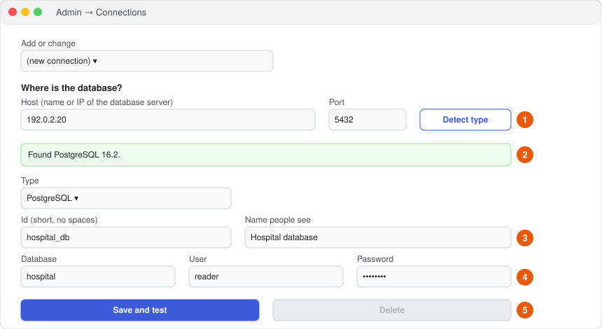

| Number | What to do |
|---|---|
| **1** | Leave **Add or change** on **(new connection)**. Type the **Host** (e.g. `192.0.2.20`) and **Port** (e.g. `5432`), then click **Detect type**. No password is needed for this step. |
| **2** | A green line such as `Found PostgreSQL` means it worked and **Type** is filled in for you. A yellow line explains what is wrong (wrong port, server not reachable, …). |
| **3** | Give the connection a short **Id** (no spaces, e.g. `hospital_db`; it cannot be changed later) and a **Name people see**. |
| **4** | Fill in **Database**, **User** and **Password** (for Neo4j the database is optional). For a SQLite file on the QuillBench server, choose **SQLite** as the type and give the file's **Path** instead. |
| **5** | Click **Save and test**. A green message means QuillBench logged in and read the database. If it shows an error, correct the details and click again. |

Usual ports, if you are unsure: PostgreSQL `5432`, MySQL/MariaDB `3306`, Neo4j `7687`
(use the **Bolt** port, not the `7474` web page port).

Good to know:

- Passwords are stored only on the QuillBench server, in a file only the server account can
  read. People writing entries **never** see the login details, only the name.
- To change a connection later, pick it in **Add or change**. Leaving the password empty
  keeps the saved one.
- If the server says the driver is missing (e.g. `psycopg`), ask whoever installs QuillBench
  to run, **on the server**, `~/quillbench-env/bin/pip install 'quillbench[postgres]'`
  (or `[mysql]` for MySQL), then restart QuillBench (section 10.6).

### 7.2 Create the benchmark project

Go to **Admin → Projects → New project** and choose **Build a new benchmark**.

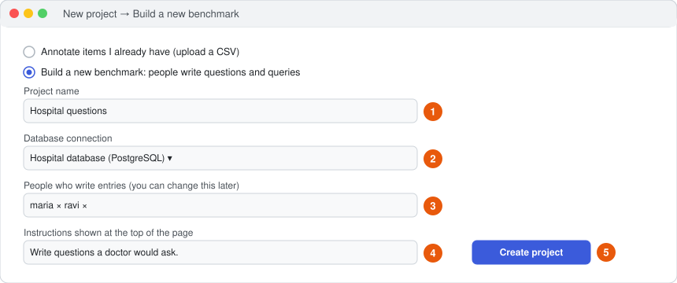

| Number | What to do |
|---|---|
| **1** | **Project name**, e.g. `Hospital questions`. |
| **2** | **Database connection:** the one from 7.1. (The button stays grey until you choose one.) |
| **3** | **People who write entries.** You can change this later. |
| **4** | **Instructions** shown at the top of their page. |
| **5** | Click **Create project**. |

The project starts with a ready-made form: a text block, the database schema, and the
question, query and result boxes. You can use it as it is, or change it in the next step.

### 7.3 Design the form

With the benchmark project chosen under **Project** (Admin → Projects), you see the form
designer. It works like Google Forms.

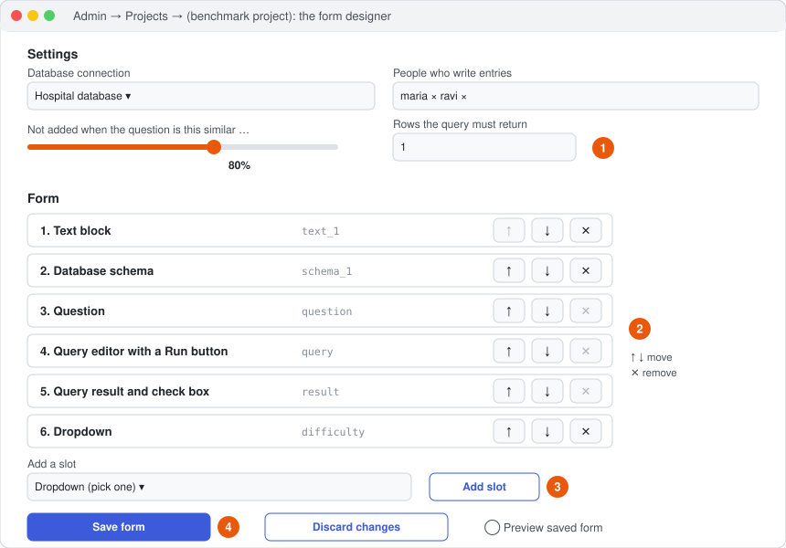

| Number | What to do |
|---|---|
| **1** | **Settings.** The database connection and the people. The **similarity slider** (normally **80%**): a new question this similar to an accepted one is *not added*. **Rows the query must return** (normally **1**, so an empty result cannot be added). |
| **2** | **The slots**, top to bottom as people will see them. Use **↑ ↓** to move a slot and **✕** to remove it. Each slot has a **Label** and optional **Help text**. Question, Query and Result are always required, so their ✕ is grey. |
| **3** | **Add a slot:** choose a type, click **Add slot**. It appears at the bottom; move it up with ↑. |
| **4** | **Save form.** Nothing changes for people until you click this. **Discard changes** throws away unsaved edits. |

The slot types you can add:

| Slot | What people see | Saved as a column? |
|---|---|---|
| Text block | Your instructions or domain notes (Markdown allowed) | no |
| Database schema | The live list of tables and columns, with a search box | no |
| Worked examples | Example question + query pairs, each with a **Run this example** button | no |
| Question | A box to write the question | **yes** (always) |
| Query editor | A box for the query and a **Run query** button | **yes** (always) |
| Query result and check box | The result table and a tick box ("The result answers the question") | **yes** (always) |
| Label buttons / Dropdown | Pick one option (e.g. difficulty: Easy / Medium / Hard) | yes |
| Tick boxes | Pick any number of options | yes |
| Slider | A number in a range | yes |
| Short answer / Paragraph | Free text | yes |

Extra slots that save a column have a **Required** tick box. If ticked, an entry cannot be
added until it is filled in.

**Check your work:** switch on **Preview saved form** to see exactly what people will see.
Careful: entries you add in the preview are **real** and go into the benchmark.

### 7.4 What the people writing entries see

They choose the project in the left menu and open the **Create** tab.

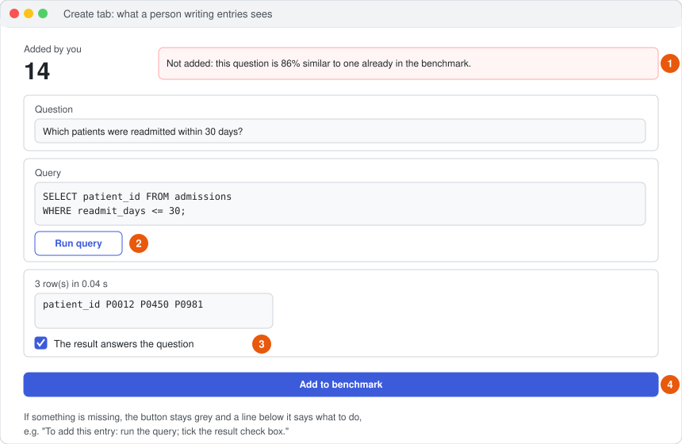

| Number | What happens |
|---|---|
| **1** | Their count of **added** entries, and the message from their last attempt (green = added, red = not added and why). |
| **2** | They write the query and click **Run query**. The result appears below. |
| **3** | They look at the result and tick the check box if it really answers the question. |
| **4** | **Add to benchmark** becomes blue only when everything is ready (next picture). |

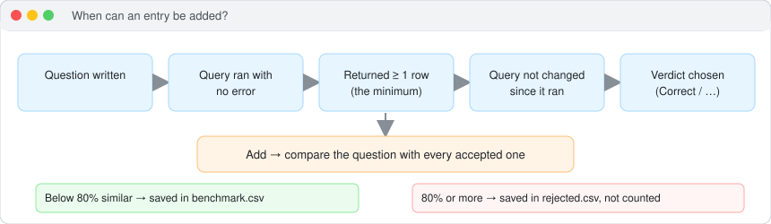

- Every added entry gets a **random, never-repeating id** such as `q_3fa91c0e`.
- Only the **question** is compared for similarity (not the query).
- A rejected entry is **not counted** for the person, but it is kept in `rejected.csv` with its
  similarity score, its own id, and the id of the entry it matched. Nothing is thrown away.
- If the person edits the query after running it, they must run it again.

---

## 8. Watching progress and downloading results

### Annotation projects

- **Progress tab:** how far each person and each batch has got.
- **Admin → Export & backup:** choose the projects (empty = all), keep
  **Replace annotator ids with codes** ticked if you will share the data, click
  **Export answers**, then **Download answers.csv** and **Download DATASHEET.md**
  (a description of the data, useful for papers).

### Benchmark projects

**Progress tab** (admins see more than other people):

- totals: entries in the benchmark, entries not added, number of people;
- a table of added / not added per person;
- **Download benchmark.csv** (accepted entries) and **Download rejected.csv**;
- the 50 most recent rejected entries next to the question they matched;
- click **Refresh** to update the numbers.

`benchmark.csv` has the columns `id, author, created_at, question, query, row_count`, plus one
column per extra slot you added.

---

## 9. Archiving, backups, and keeping data safe

### Hide a finished project (archive)

**Admin → Workspaces & archive.** Open the project, tick **Archive this workspace** (or a
single project inside it), click **Save**. Annotators no longer see it. **Nothing is deleted
or moved**, and you can untick it at any time.

> QuillBench has no "delete project" button on purpose. Archive instead.

### Backups

- A backup runs **every night** automatically.
- To make one right now: **Admin → Export & backup → Back up now**, or on the server:

```bash
quillbench backup
```

Always make a backup before updating QuillBench or making big changes.

### Golden rules

1. Never delete files in the server's data folders by hand.
2. Restarting QuillBench is safe; answers are saved the moment people click.
3. Removing a label, a column or a batch file can confuse old answers. Add, don't remove.
4. Keep admin passwords private. Make admins only for people who really need it.

---

## 10. Everything from the terminal (reference)

Do [section 4](#4-using-the-terminal-only-for-a-few-tasks) first (log in to the server and
make `quillbench` available). Words in CAPITALS are things you replace.

### 10.1 People

| Task | Command |
|---|---|
| List everyone | `quillbench user list` |
| Add an admin | `quillbench user add USERID --admin --display "Full Name"` |
| Add an annotator | `quillbench user add USERID --display "Full Name"` |
| Add a university (LDAP) user | `quillbench user add USERID --ldap` |
| Make admin / annotator | `quillbench user role USERID admin` · `quillbench user role USERID annotator` |
| New password | `quillbench user passwd USERID` |
| Block / unblock | `quillbench user disable USERID` · `quillbench user enable USERID` |

### 10.2 Projects (workspaces)

| Task | Command |
|---|---|
| List projects and their ids | `quillbench workspace list` |
| Check a project for problems | `quillbench validate PROJECTID` |
| Progress per person and batch | `quillbench status PROJECTID` |
| Agreement between annotators | `quillbench quality PROJECTID` |
| Export answers | `quillbench export PROJECTID` |

Projects made on the web page are found automatically. You only need the commands below for a
project prepared by hand as a folder (advanced):

```bash
quillbench init-workspace ~/my_paper/annotation --name "My paper"
```

This creates the folder with a settings file (`quillbench_workspace.yaml`) and a `batches`
folder. Put your batch files (CSV or JSONL) in `batches`, edit the settings file, then:

```bash
quillbench validate ~/my_paper/annotation
```

```bash
quillbench workspace add ~/my_paper/annotation
```

### 10.3 Assignments

Give batches to a person (batch names are shown in Admin → Projects or by `status`):

```bash
quillbench assign ravi PROJECTID batch_001 batch_002
```

Take them away again (their answers are kept):

```bash
quillbench assign ravi PROJECTID batch_002 --remove
```

### 10.4 Backups

```bash
quillbench backup
```

### 10.5 Where the data lives on the server

| What | Where |
|---|---|
| Accounts, settings, connections | `~/.config/quillbench/` |
| Projects made on the web page | `~/.config/quillbench/projects/PROJECTID/` |
| Benchmark files | `~/.config/quillbench/projects/PROJECTID/benchmark/benchmark.csv` and `rejected.csv` |
| Projects prepared by hand | wherever you created them (see `quillbench workspace list`) |
| Backups | the folder set in your server's settings (`quillbench backup` prints it) |

### 10.6 Restart, status and logs

QuillBench runs as a background service called `quillbench`.

| Task | Command |
|---|---|
| Is it running? | `systemctl --user status quillbench` (press `q` to leave) |
| Restart it | `systemctl --user restart quillbench` |
| Last 50 log lines | `journalctl --user -u quillbench -n 50 --no-pager` |

---

## 11. When something goes wrong

| Problem | What to do |
|---|---|
| **"Wrong user ID or password"** | Check the user exists: `quillbench user list` (on the server). Check it says `active`. Reset the password: `quillbench user passwd USERID`. User IDs are case-sensitive. |
| **I can't see the Admin tab** | Your account is an annotator. Another admin runs `quillbench user role YOURID admin` on the server. University (LDAP) accounts can never be admins. |
| **The page does not load** | On the server: `systemctl --user status quillbench`. If it is not `active (running)`, run `systemctl --user restart quillbench` and check the logs (10.6). |
| **An annotator sees "Nothing is assigned to you"** | Assign them a batch (6.4), or for a benchmark add them under **People who write entries** (7.3) and click **Save form**. |
| **Detect type says nothing answered / timed out** | The host or port is wrong, or a firewall blocks the QuillBench server from reaching the database. Ask the database owner which port is open to the QuillBench server. |
| **Detect type found a web page on the Neo4j port** | Use the Bolt port (usually `7687`), not `7474`. |
| **Save and test fails with a login error** | Wrong user, password or database name. Re-type them and click **Save and test** again. |
| **"driver is not installed"** | See the last tip in 7.1. Remember: run the install **on the server**, not on your laptop. |
| **People say "The form is not ready yet"** | Open the form designer, choose a database connection in Settings, and click **Save form**. Red messages list what is missing. |
| **Add to benchmark stays grey** | Read the line under the button; it lists what is missing (run the query, tick the box, fill a required slot, …). |
| **Uploading a CSV fails** | Save the file as **CSV UTF-8**, make sure the first row has column names, and that ids are unique. |
| **Command not found: quillbench** | You skipped step 4.3, or you are on your laptop instead of the server (4.2). |
