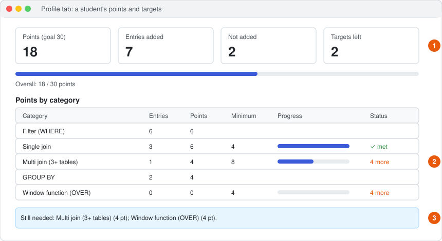

# Writing benchmark questions: a student's walk-through

This guide follows one student, **Mina**, from the moment she gets her login to the moment
she has met all her targets. Everything she sees and clicks is described, in order. If you
are a student in a benchmark project, do what Mina does.

> The names, addresses and numbers here are examples. Your teacher gives you the real web
> address, your user ID and your password.

---

## Contents

1. [Before you start](#1-before-you-start)
2. [Signing in](#2-signing-in)
3. [Finding your way around](#3-finding-your-way-around)
4. [Reading the database](#4-reading-the-database)
5. [Writing the first question](#5-writing-the-first-question)
6. [Writing and running the query](#6-writing-and-running-the-query)
7. [Checking the result and giving your verdict](#7-checking-the-result-and-giving-your-verdict)
8. [Adding it to the benchmark](#8-adding-it-to-the-benchmark)
9. [When something goes wrong](#9-when-something-goes-wrong)
10. [Looking at your scores: the Profile tab](#10-looking-at-your-scores-the-profile-tab)
11. [Planning the next questions](#11-planning-the-next-questions)
12. [Finishing](#12-finishing)
13. [Rules and tips](#13-rules-and-tips)

---

## 1. Before you start

Mina's teacher sends her a message:

> Web address: `http://quillbench.example.org/quillbench/`
> User ID: `mina`
> Password: `(a password)`
> Project: *Traffic benchmark*. Goal: 30 points, including at least 8 points of multi-join
> questions and 4 points of window-function questions.

What Mina needs:

- a computer with Chrome, Firefox, Edge or Safari (a phone works, but a big screen is much
  easier for reading tables);
- basic SQL: `SELECT`, `WHERE`, `JOIN`, `GROUP BY`. She does not need to install anything.

What she is going to do, in one sentence: **read the traffic database, think of a question
someone would really ask about it, write the SQL query that answers it, run the query, check
the answer, and add it.** Every good entry earns points.

---

## 2. Signing in

Mina opens the web address in her browser.


| Number | What Mina does |
|---|---|
| **1** | Types her **User ID**, `mina`. It is case-sensitive: `Mina` would not work. |
| **2** | Types her **Password**. The dots are normal. |
| **3** | Clicks **Sign in** (or presses Enter). |

If she sees **"Wrong user ID or password."** she checks for typing mistakes and Caps Lock.
After several wrong tries the page says **"Too many wrong attempts. Try again in 15
minutes."**, so she waits, or asks the teacher to reset the password.

She stays signed in until she clicks **Sign out**, even if she closes the browser.

---

## 3. Finding your way around


| Number | What it is |
|---|---|
| **1** | **Workspace** menu on the left. It shows *Traffic benchmark*. If Mina is in more than one project, she chooses it here. |
| **2** | The tabs: **Create** (write entries, this is where she works), **Progress** (her count), **Profile** (her scores and targets). |
| **3** | **Added by you:** how many of her entries are in the benchmark. It starts at 0. |
| **4** | **Sign out**, when she is finished. |

The blue box under the counter is the teacher's instruction for the whole project. Mina reads
it first.

If she sees **"Nothing is assigned to you right now"**, the teacher has not added her to the
project yet. She tells the teacher.

---

## 4. Reading the database

The **Create** tab is a long form. Mina scrolls down slowly from the top. First comes
**About this task** (what to do), then the parts that describe the database.


| Number | What it is |
|---|---|
| **1** | **Find a table or column.** Mina types `speed`; only tables that have *speed* in their name or columns stay in the list. She clears the box to see everything again. |
| **2** | **The schema:** every table with its columns, e.g. `reading(sensor_id, ts, speed, volume)` means the table `reading` has the columns `sensor_id`, `ts`, `speed` and `volume`. It is read live from the real database. |
| **3** | **Worked examples:** questions and queries the teacher wrote. **Run this example** shows the real result, so Mina sees what the data looks like. |

Mina spends five minutes here. She notices:

- `road` has `id`, `name`, `city`;
- `sensor` has `id`, `road_id`, `lane`, so a sensor belongs to a road through `road_id`;
- `reading` has one row per sensor per time, with `speed` and `volume`.

So to talk about roads *and* speeds she needs `reading → sensor → road`: a join of three
tables.

> **Tip:** run every example once. It is the fastest way to learn what values look like
> (e.g. is `ts` written `2024-03-01 08:00` or a number?).

---

## 5. Writing the first question

Mina scrolls to the **Question** box and writes it the way a person would ask it, not the
way SQL is written:

> What was the average speed on each road in Tokyo on 1 March 2024, fastest first?

Good questions:

- are **specific** (which city, which day);
- have **one clear answer** in this database;
- sound **natural**, like something a traffic engineer or a driver would ask.

Avoid:

- copying a worked example with one word changed (it will be rejected as too similar, see
  section 8);
- questions the data cannot answer (e.g. "Why is traffic bad?").

Before writing the query, Mina clicks **Check similarity** under the question box. It says how
close her question is to the nearest one already in the benchmark, e.g. *"Closest existing
question is 48% similar (a classmate's question). The limit is 80%, so this can be added."*
If it says *would not be added*, she rewrites the question first and saves herself the work.

---

## 6. Writing and running the query

In the **SQL query** box Mina writes:

```sql
SELECT r.name, AVG(x.speed) AS avg_speed
FROM reading x
JOIN sensor s ON s.id = x.sensor_id
JOIN road r   ON r.id = s.road_id
WHERE r.city = 'Tokyo'
  AND x.ts >= '2024-03-01' AND x.ts < '2024-03-02'
GROUP BY r.name
ORDER BY avg_speed DESC
```

Then she clicks **Run query** under the box.

What she should know about running queries:

- Only **reading** queries run (`SELECT` or `WITH`). Anything that changes data is refused.
- One statement at a time: no second query after a `;`.
- A query that runs too long (usually 30 seconds) is stopped. Add a `WHERE` to narrow it.
- She can run as often as she likes. Nothing is saved until she clicks **Add to benchmark**.

---

## 7. Checking the result and giving your verdict

Below the query, the **Result** box fills in.


The picture shows a different, shorter example; Mina's page has the same parts.

| Number | What Mina sees and does |
|---|---|
| **1** | The message area next to her counter (empty for now). |
| **2** | **Run query**, which she just clicked. |
| **3** | **"Is the result right for your question?"** She chooses **Correct**, **Incorrect** or **Uncertain**. |
| **4** | **Add to benchmark** (section 8). |
| **5** | **Complexity and categories.** The system read her query by itself. |

Mina's result shows `3 row(s) in 0.04 s` and a table with two columns, `name` and
`avg_speed`. Above the verdict buttons she sees:

> **Complexity: Very hard** · 4 points (from *Multi join (3+ tables)*)
> Categories found: `Filter (WHERE)` `Multi join (3+ tables)` `AVG` `GROUP BY` `ORDER BY (sorting)` `Date and time`

What this means:

- **Categories** are the SQL features the system found in her query. Nobody picks them by
  hand, and she cannot change them, except by changing the query.
- **Points:** a query earns the points of its **single most valuable category**, not the sum.
  Here *Multi join* is worth 4, so the query is worth **4 points** even though AVG and GROUP BY
  are in it too.
- **Complexity** is Easy, Medium, Hard or Very hard, from the hardest category.

Now the important part: **is the result really right?** Mina checks:

- Are there three roads in Tokyo? She compares with the `road` table in the schema, or runs a
  quick `SELECT name FROM road WHERE city = 'Tokyo'` and then puts her query back.
- Do the speeds look sensible (not 0, not 900)?
- Is it sorted fastest first, as the question says?

Everything looks right, so she chooses **Correct**.

When to choose the others:

| Verdict | Use it when | Points |
|---|---|---|
| **Correct** | You checked, and the result answers the question. | yes |
| **Incorrect** | The query runs but the result is wrong, and you cannot fix it. | no |
| **Uncertain** | You are not sure: the data is odd, or the question can be read two ways. | no |

Be honest. These verdicts are data for the benchmark too, and the teacher can see them. A
wrong "Correct" is worse than an honest "Uncertain". (Your teacher may have renamed these
buttons or added more. The idea is the same.)

---

## 8. Adding it to the benchmark


**Add to benchmark** turns blue only when **all** of these are true:

1. the question is written;
2. the query ran without an error;
3. it returned at least 1 row (or the minimum your teacher set);
4. the query has **not been changed** since it ran (a single extra space counts as a change, so
   run it again);
5. a verdict is chosen (and it is one the teacher allows to be added);
6. any extra box marked as required is filled in.

While something is missing, a grey line under the button says exactly what, for example:

> To add this entry: run the query; choose Correct / Incorrect / Uncertain.

Mina clicks **Add to benchmark**. One of two things happens:


| Number | What it means |
|---|---|
| **1** | **Added.** Green message: *"Added to the benchmark as q_7c21e04a: Very hard query, +4 points."* `q_7c21e04a` is the entry's id; every entry gets its own, never repeated. **Added by you** goes up by one, and the form is emptied for the next question. |
| **2** | **Not added.** Red message: *"Not added: this question is 91% similar to one already in the benchmark."* Someone (maybe herself, maybe a classmate) already added almost the same question. The counter does **not** go up and there are no points. Her text stays in the boxes, so she can rewrite the question to ask something genuinely different, run again and add again. |

About similarity:

- Only the **question text** is compared, not the query.
- The limit is usually **80%**. Changing "average" to "mean" is not enough; ask about a
  different thing (another city, another time, another measure).
- Rejected attempts are kept for the teacher, with the score and the question they matched,
  but they do not count against you.

---

## 9. When something goes wrong


| Number | Message | What to do |
|---|---|---|
| **1** | A database error, e.g. `no such table: roads` | A typing mistake. Check names against the schema (`road`, not `roads`). |
| **2** | `Not run: only read queries (SELECT or WITH) can run.` | Your query does not start with `SELECT`/`WITH`, or has two statements. Other "Not run" messages name the word that is not allowed. |
| **3** | `The query returned no rows…` | The query is valid but finds nothing. Check the values you filter on (spelling, upper/lower case, date format). |

Other situations:

| Situation | What to do |
|---|---|
| "The query changed since it last ran. Run it again." | Click **Run query** again. |
| "The query took longer than 30 s and was stopped." | Narrow it with `WHERE`, or avoid joining huge tables without a condition. |
| The schema says "Could not read the schema" | The database is not reachable. Tell the teacher; try again later. |
| "This project's form is not ready yet." | The teacher is still setting it up. Wait. |
| The categories look wrong for your query | Tell the teacher, with the query. The rules can be fixed, and points are recalculated for everyone. |

---

## 10. Looking at your scores: the Profile tab

After a few entries, Mina clicks **Profile** at the top.



| Number | What Mina sees |
|---|---|
| **1** | **Points (goal 30):** her total so far. **Entries added**, **Not added** (too similar), and **Targets left**: how many goals are still open (each category minimum, plus the overall goal). The bar shows *Overall: 18 / 30 points*. |
| **2** | **Points by category**, one row per category she has used or has a target in: how many entries use it, the points for it, the **Minimum** the teacher set, a progress bar, and **✓ met** or **4 more**. |
| **3** | **Still needed:** a plain list of what is missing, e.g. *Multi join (3+ tables) (4 pt); Window function (OVER) (4 pt)*. |

Below that:

- **Complexity of your entries:** e.g. *Easy 3, Medium 2, Very hard 2*;
- **Your verdicts:** e.g. *Correct 6, Uncertain 1*;
- **Entries (7):** click to open a table of everything she added: id, question, complexity,
  categories, verdict and points;
- **How points and complexity work:** the full list of categories with their points and
  minimums, and which category gives which complexity.

How to read the two kinds of numbers:

- Her **total** counts each entry **once**, with the points of its best category. Her first
  query (multi join + AVG + GROUP BY) added **4** to the total.
- The **category table** shows what she has *used*. That same query appears in the Multi join
  row, the AVG row and the GROUP BY row, because it helps with the minimum of each.

Entries marked **Incorrect** or **Uncertain** appear in her list and in her verdict count but
give **0** points.

The **Progress** tab shows only the number of entries she added. The Profile tab is the one to
use.

---

## 11. Planning the next questions

Mina's profile says she still needs 4 points of multi join and 4 points of window functions.
So she plans questions that **need** those features, instead of writing easy ones:

| Still needed | A question that needs it |
|---|---|
| Multi join | "Which roads in Osaka had a sensor reading above the speed limit?" (reading → sensor → road → speed_limit) |
| Window function | "For each road, rank the hours of 1 March by traffic volume." (`RANK() OVER (PARTITION BY … ORDER BY …)`) |
| HAVING | "Which roads had an average speed below 20 km/h on more than three days?" |
| Date and time | "How did average speed change by hour of the day on road A1?" |

She writes, runs, checks and adds each one, and watches **Targets left** go down.

> **Do not chase points with tricks.** Adding a pointless `JOIN` or `OVER()` to an easy question
> may get through the category check, but the teacher reads the entries, and the benchmark
> needs questions where the hard part is *really needed* to answer them.

---

## 12. Finishing

Mina is done when the Profile tab shows **Targets left: ✓** and the overall bar is full. She
can still add more entries; they keep counting.

Before leaving she clicks **Sign out** (left side), especially on a shared computer.

Her work is saved the moment each **Add to benchmark** succeeds. There is nothing else to
submit.

---

## 13. Rules and tips

1. **One question, one query, one clear answer.**
2. **Write the question first, then the query.** Not the other way round.
3. **Check the result before you choose Correct.** Run small checking queries if needed.
4. **Be honest with verdicts.** *Uncertain* is a useful answer.
5. **Make it different.** Questions 80% or more similar to an existing one are not added.
6. **Use the hard features only where the question needs them.**
7. **Never share your password.** Everything you add is saved under your name.
8. **Ask your teacher** when the database, the schema or the categories look wrong.
