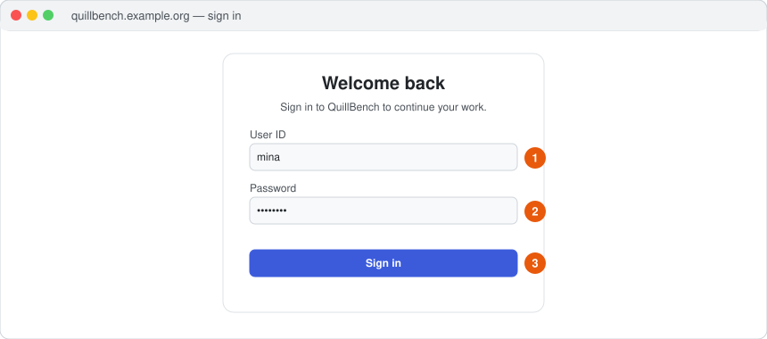
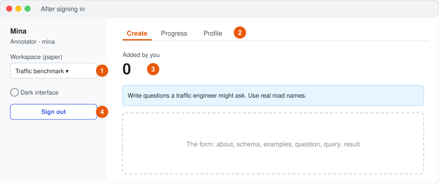
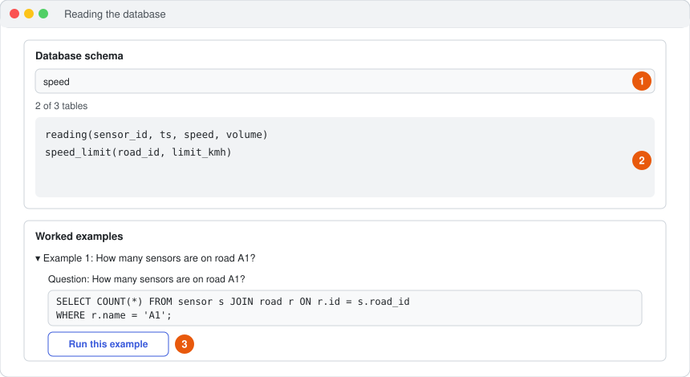
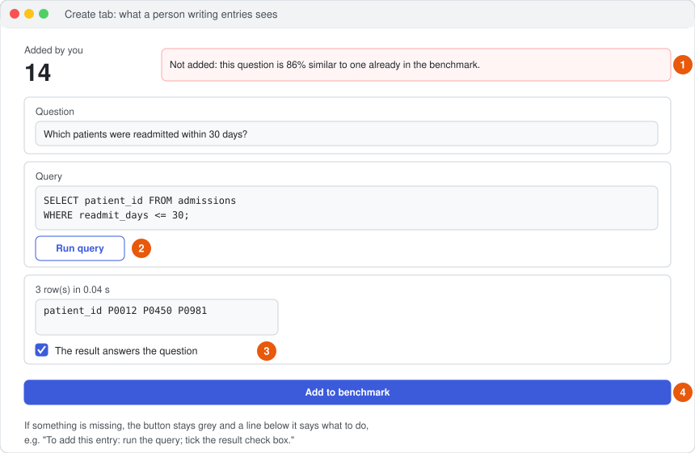
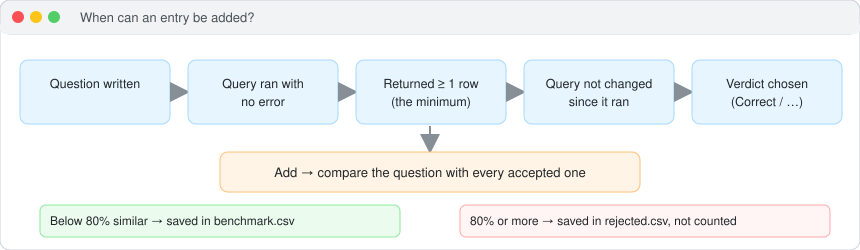
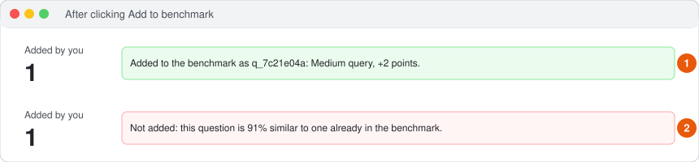
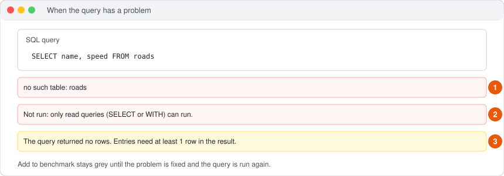

# Writing benchmark questions: a student's walk-through

This guide follows one student, **Mina**, from the moment she gets her login to the moment
she has met all her targets. Everything she sees and clicks is described, in order. If you
are a student in a benchmark project, do what Mina does.

> The names, addresses and numbers here are examples. Your teacher gives you the real web
> address, your user ID and your password.

---

## Contents

1. [Before you start](#1-before-you-start)
2. [Signing in](#2-signing-in)
3. [Finding your way around](#3-finding-your-way-around)
4. [Reading the database](#4-reading-the-database)
5. [Writing the first question](#5-writing-the-first-question)
6. [Writing and running the query](#6-writing-and-running-the-query)
7. [Checking the result and giving your verdict](#7-checking-the-result-and-giving-your-verdict)
8. [Adding it to the benchmark](#8-adding-it-to-the-benchmark)
9. [When something goes wrong](#9-when-something-goes-wrong)
10. [Looking at your scores: the Profile tab](#10-looking-at-your-scores-the-profile-tab)
11. [Planning the next questions](#11-planning-the-next-questions)
12. [Finishing](#12-finishing)
13. [Rules and tips](#13-rules-and-tips)

---

## 1. Before you start

Mina's teacher sends her a message:

> Web address: `http://quillbench.example.org/quillbench/`
> User ID: `mina`
> Password: `(a password)`
> Project: *Traffic benchmark*. Goal: 30 points, including at least 8 points of multi-join
> questions and 4 points of window-function questions.

What Mina needs:

- a computer with Chrome, Firefox, Edge or Safari (a phone works, but a big screen is much
  easier for reading tables);
- basic SQL: `SELECT`, `WHERE`, `JOIN`, `GROUP BY`. She does not need to install anything.

What she is going to do, in one sentence: **read the traffic database, think of a question
someone would really ask about it, write the SQL query that answers it, run the query, check
the answer, and add it.** Every good entry earns points.

---

## 2. Signing in

Mina opens the web address in her browser.



| Number | What Mina does |
|---|---|
| **1** | Types her **User ID**, `mina`. It is case-sensitive: `Mina` would not work. |
| **2** | Types her **Password**. The dots are normal. |
| **3** | Clicks **Sign in** (or presses Enter). |

If she sees **"Wrong user ID or password."** she checks for typing mistakes and Caps Lock.
After several wrong tries the page says **"Too many wrong attempts. Try again in 15
minutes."**, so she waits, or asks the teacher to reset the password.

She stays signed in until she clicks **Sign out**, even if she closes the browser.

---

## 3. Finding your way around



| Number | What it is |
|---|---|
| **1** | **Workspace** menu on the left. It shows *Traffic benchmark*. If Mina is in more than one project, she chooses it here. |
| **2** | The tabs: **Create** (write entries, this is where she works), **Progress** (her count), **Profile** (her scores and targets). |
| **3** | **Added by you:** how many of her entries are in the benchmark. It starts at 0. |
| **4** | **Sign out**, when she is finished. |

The blue box under the counter is the teacher's instruction for the whole project. Mina reads
it first.

If she sees **"Nothing is assigned to you right now"**, the teacher has not added her to the
project yet. She tells the teacher.

---

## 4. Reading the database

The tables live on their own tab. Mina clicks **Schema** at the top.



| Number | What Mina sees and does |
|---|---|
| **1** | **All tables at a glance** (at the bottom of the tab; click it to open, shown open here): every table on one line, with its columns and types, e.g. `holiday(h_date date [PK], holiday_name varchar, …) -- 休日祝日`. `[PK]` marks the column that identifies each row; `[→ road.id]` means the column points to the `id` of the `road` table. The **copy** button at the top right copies the whole list, e.g. to paste into an AI assistant while working out a query. |
| **2** | **Choose a table:** a dropdown at the top of the tab. She can type part of a name to find it. Each name shows the description stored in the database. |
| **3** | The table's name, its number of columns, about how many rows it has, and a **note from the teacher** if there is one. Notes explain things like codes and units. Read them. |
| **4** | Every column with its type (and key and description when the database has them). |
| **5** | **The first 10 rows**, so she sees what the values really look like. |

Below that, **Other tables with the same column names** lists tables sharing a column with this one, which is usually how two tables are joined.

Some tables are split into parts, one per month (e.g. `link_congestion_201904`, `…_201905`). The page says so. When it says *"Query link_congestion to use them all"*, the main name reads every month; otherwise she queries the month she needs.

Mina spends five minutes here. She notices:

- `holiday` has one row per holiday, with a real date in `h_date`;
- `link_congestion` has `offer_day` as a **number** like `20190501`, not a date;
- `course_name` holds the road name, e.g. `国道４号`.

> **Tip:** always look at the first 10 rows before writing a query. It is the fastest way to
> learn how values are written.

Back on **Create**, the page starts with **About this task** and any **Worked examples** from
the teacher. **Run this example** shows an example's real result.

---

## 5. Writing the first question

Mina scrolls to the **Question** box and writes it the way a person would ask it, not the
way SQL is written:

> What was the average speed on each road in Tokyo on 1 March 2024, fastest first?

Good questions:

- are **specific** (which city, which day);
- have **one clear answer** in this database;
- sound **natural**, like something a traffic engineer or a driver would ask.

Avoid:

- copying a worked example with one word changed (it will be rejected as too similar, see
  section 8);
- questions the data cannot answer (e.g. "Why is traffic bad?").

Before writing the query, Mina clicks **Check similarity** under the question box. A pop-up
says how close her question is to the nearest one already in the benchmark, e.g. *"Closest is
48% similar (a question already in the benchmark). The limit is 80%: this can be added."*
If it says *would not be added*, she rewrites the question first and saves herself the work.

---

## 6. Writing and running the query

In the **SQL query** box Mina writes:

```sql
SELECT r.name, AVG(x.speed) AS avg_speed
FROM reading x
JOIN sensor s ON s.id = x.sensor_id
JOIN road r   ON r.id = s.road_id
WHERE r.city = 'Tokyo'
  AND x.ts >= '2024-03-01' AND x.ts < '2024-03-02'
GROUP BY r.name
ORDER BY avg_speed DESC
```

Then she clicks **Run query** under the box.

What she should know about running queries:

- Only **reading** queries run (`SELECT` or `WITH`). Anything that changes data is refused.
- One statement at a time: no second query after a `;`.
- A query that runs too long (usually 30 seconds) is stopped. Add a `WHERE` to narrow it.
- She can run as often as she likes. Nothing is saved until she clicks **Add to benchmark**.

---

## 7. Checking the result

Below the query, the **Result** box fills in.



The picture shows a different, shorter example; Mina's page has the same parts.

| Number | What Mina sees and does |
|---|---|
| **1** | A pop-up in the corner after each Add (section 8). |
| **2** | **Run query**, which she just clicked. |
| **3** | **Complexity** (Easy, Medium, Hard or Very hard) and the **points** the query is worth if added. The system decides both by reading the query. |
| **4** | **Add to benchmark** (section 8). |

Mina's result shows `5 row(s) in 0.09 s` and a table with `course_name` and `events`. Above
it she sees **Complexity: Medium · 2 points if added**.

Before adding, she checks the result is really right:

- Do the numbers look sensible (not 0, not millions)?
- Is it sorted the way the question says?
- If unsure, she runs a small checking query and then puts her query back.

> Your teacher may also ask you to give a **verdict** (for example Correct / Incorrect /
> Uncertain) under the result. If those buttons are there, choose honestly; *Uncertain* is a
> useful answer.

---

## 8. Adding it to the benchmark



**Add to benchmark** turns blue only when **all** of these are true:

1. the question is written;
2. the query ran without an error;
3. it returned at least 1 row (or the minimum your teacher set);
4. the query has **not been changed** since it ran (a single extra space counts as a change, so
   run it again);
5. any extra box marked as required is filled in (and a verdict is chosen, if the teacher asks
   for one).

While something is missing, a grey line under the button says exactly what, for example:

> To add this entry: run the query.

Mina clicks **Add to benchmark**. One of two things happens:



| Number | What it means |
|---|---|
| **1** | **Added.** A pop-up in the top corner: *"Added as q_7c21e04a: Medium query, +2 points."* It fades after a few seconds. `q_7c21e04a` is the entry's id; every entry gets its own, never repeated. **Added by you** goes up by one, and the form is emptied for the next question. |
| **2** | **Not added.** A pop-up: *"Not added: this question is 91% similar to one already in the benchmark."* Someone (maybe herself, maybe a classmate) already added almost the same question. The counter does **not** go up and there are no points. Her text stays in the boxes, so she can rewrite the question to ask something genuinely different, run again and add again. |

About similarity:

- Only the **question text** is compared, not the query.
- The limit is usually **80%**. Changing "average" to "mean" is not enough; ask about a
  different thing (another city, another time, another measure).
- Rejected attempts are kept for the teacher, with the score and the question they matched,
  but they do not count against you.

---

## 9. When something goes wrong



| Number | Message | What to do |
|---|---|---|
| **1** | A database error, e.g. `no such table: roads` | A typing mistake. Check names against the schema (`road`, not `roads`). |
| **2** | `Not run: only read queries (SELECT or WITH) can run.` | Your query does not start with `SELECT`/`WITH`, or has two statements. Other "Not run" messages name the word that is not allowed. |
| **3** | `The query returned no rows…` | The query is valid but finds nothing. Check the values you filter on (spelling, upper/lower case, date format). |

Other situations:

| Situation | What to do |
|---|---|
| "The query changed since it last ran. Run it again." | Click **Run query** again. |
| "The query took longer than 30 s and was stopped." | Narrow it with `WHERE`, or avoid joining huge tables without a condition. |
| The schema says "Could not read the schema" | The database is not reachable. Tell the teacher; try again later. |
| "This project's form is not ready yet." | The teacher is still setting it up. Wait. |
| The categories look wrong for your query | Tell the teacher, with the query. The rules can be fixed, and points are recalculated for everyone. |

---

## 10. Looking at your scores: the Profile tab

After a few entries, Mina clicks **Profile** at the top. She sees:

- **Points (goal 30):** her total so far, and a bar such as *Overall: 6 / 30 points*;
- **Entries added** and **Not added (too similar)**;
- **Targets left:** how many of the teacher's goals are still open;
- **Still needed:** which kinds of query she has not done enough of yet, e.g. *Multi join (3+
  tables), Window function (OVER)*;
- **Complexity of your entries:** e.g. *Medium 1, Very hard 1*;
- **Your entries:** every entry she added, with its id, question, complexity and points (and
  her verdict, if the teacher asks for verdicts).

How the points are worked out is not shown to students; the teacher decides it. A query that
uses harder SQL is worth more.

The **Progress** tab shows only the number of entries she added. The Profile tab is the one to
use.

---

## 11. Planning the next questions

Mina's profile says she still needs *Multi join* and *Window function* queries.
So she plans questions that **need** those features, instead of writing easy ones:

| Still needed | A question that needs it |
|---|---|
| Multi join | "Which roads in Osaka had a sensor reading above the speed limit?" (reading → sensor → road → speed_limit) |
| Window function | "For each road, rank the hours of 1 March by traffic volume." (`RANK() OVER (PARTITION BY … ORDER BY …)`) |
| HAVING | "Which roads had an average speed below 20 km/h on more than three days?" |
| Date and time | "How did average speed change by hour of the day on road A1?" |

She writes, runs, checks and adds each one, and watches **Targets left** go down.

> **Do not chase points with tricks.** Adding a pointless `JOIN` or `OVER()` to an easy question
> may get through the category check, but the teacher reads the entries, and the benchmark
> needs questions where the hard part is *really needed* to answer them.

---

## 12. Finishing

Mina is done when the Profile tab shows **Targets left: ✓** and the overall bar is full. She
can still add more entries; they keep counting.

Before leaving she clicks **Sign out** (left side), especially on a shared computer.

Her work is saved the moment each **Add to benchmark** succeeds. There is nothing else to
submit.

---

## 13. Rules and tips

1. **One question, one query, one clear answer.**
2. **Write the question first, then the query.** Not the other way round.
3. **Check the result before you add it.** Run small checking queries if needed.
4. **Use the Schema tab.** Look at the first 10 rows of every table you use.
5. **Make it different.** Questions 80% or more similar to an existing one are not added.
6. **Use the hard features only where the question needs them.**
7. **Never share your password.** Everything you add is saved under your name.
8. **Ask your teacher** when the database, the schema or the categories look wrong.
